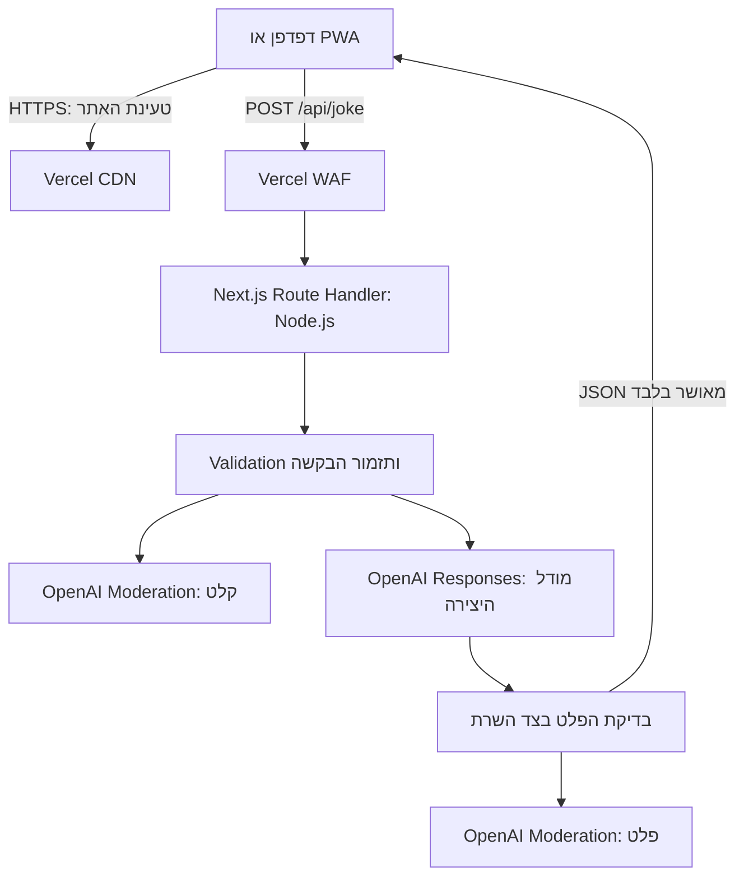

# ARCHITECTURE — אתר ליצירת בדיחות לפי נושא

תאריך המחקר: 21 באוקטובר 2026.

המסמך מבוסס על PRD.md. המוצר פועל ללא תשלום חדש (ADR-3): האחסון בתוכנית חינמית, ושירות ה־AI הוא OpenAI, שמשתמש ביתרה הקיימת בחשבון של המשתמש. בחירת המודל מתועדת ב־ADR-1. ההחלטות המרכזיות מרוכזות בסעיף ADRs בסוף המסמך.

## 1. Technology Stack שנבחר

| רכיב | טכנולוגיה | תפקיד |
| --- | --- | --- |
| שפת פיתוח | TypeScript במצב strict | טיפוסים משותפים ל־Frontend ול־Backend ובדיקות בזמן Build |
| אפליקציית Web | Next.js 16, App Router, עם React בגרסה התואמת ל־Next.js | מסך המשתמש ו־HTTP API בפרויקט אחד |
| עיצוב | CSS Modules ו־Global CSS מצומצם | עיצוב Responsive, עברית ו־RTL ללא ספריית UI נוספת |
| Backend Runtime | Node.js 24 LTS | הרצת Route Handler בצד השרת |
| אינטגרציית AI | OpenAI SDK הרשמי ל־JavaScript/TypeScript, חבילת `openai` | פנייה ישירה מ־Backend ל־Responses API ול־Moderation API |
| יצירת תוכן | מודל זול של OpenAI, ברירת מחדל `gpt-6-luna` (נקבע בהגדרה `OPENAI_MODEL`) | יצירת בדיחה והכרעה על התאמת הנושא בקריאה אחת |
| Moderation | omni-moderation-latest | סינון תוכן מזיק בקלט ובפלט, ללא עלות |
| בדיקות | Vitest | בדיקות יחידה וחוזה עם Mocks, ללא קריאות AI אמיתיות |
| PWA | Web App Manifest מובנה ב־Next.js, אייקונים ו־HTTPS | התקנה והפעלה במצב standalone במכשירים תומכים |
| Hosting | Vercel Hobby (חינמי), עם Vercel Functions ו־Fluid Compute | הגשת נכסים סטטיים והרצת ה־Backend באותו Origin |
| הגנת תעבורה | Vercel WAF Rate Limiting | שמירה על היתרה מפני ניצול לרעה |
| קוד ופריסה | GitHub וחיבור Git המובנה ב־Vercel | ניהול גרסאות ופריסה אוטומטית מ־main (החיבור ל־Vercel רק באבן הדרך של הפריסה, ADR-5) |
| נתונים | זיכרון זמני בלבד | נושא ובדיחה במהלך השימוש; אין Database או היסטוריה |

יש לקבע את גרסאות התלויות המדויקות ב־package-lock.json בעת יצירת הפרויקט ולהשתמש ב־npm ci. נבחרת גרסה יציבה ומתוקנת של Next.js 16, ללא Canary; גרסת React נלקחת לפי התאימות הרשמית של Next.js. Node.js 24.x נקבע גם בפרויקט וגם ב־Vercel. [Next.js Installation](https://nextjs.org/docs/app/getting-started/installation), [Vercel Node.js Versions](https://vercel.com/docs/functions/runtimes/node-js/node-js-versions).

### 1.1 נימוקי הבחירה

**Frontend ו־Backend משולבים:** נבחנו Next.js עם Route Handlers, React עם Vite ו־Backend נפרד, ו־Vue עם Vite ו־Backend נפרד. Next.js נבחר משום שהמוצר מחייב Backend לשמירת המפתח, והוא מרכז פיתוח מקומי, Build ופריסה בפרויקט אחד. אין צורך בשרת Express נוסף. [Route Handlers](https://nextjs.org/docs/app/getting-started/route-handlers).

**עיצוב:** נבחנו CSS Modules ו־Tailwind CSS. עבור טופס אחד ואזור תוצאה, CSS Modules מספקים בידוד סגנונות ותמיכה ישירה של Next.js עם מעט תלויות. [Next.js CSS](https://nextjs.org/docs/app/getting-started/css).

**Hosting:** נבחנו Vercel, Netlify ו־Cloudflare Workers. Vercel נבחר בהתאם להעדפת המשתמש, לחיבור הישיר ל־GitHub ולתמיכה ב־Next.js. תוכנית Hobby חינמית ואינה דורשת אמצעי תשלום. [Vercel GitHub](https://vercel.com/docs/git/vercel-for-github), [Hobby](https://vercel.com/docs/plans/hobby).

**AI:** למשתמש יש מפתח OpenAI עם יתרה קיימת, ולכן נשאר OpenAI. נבחנה גם חלופת Gemini במסלול החינמי; היא נדחתה משום שיש בה מכסה יומית נמוכה, ו־Google עשויה להשתמש בתוכן המסלול החינמי לשיפור מוצריה. GPT-5 נפסל משום שגרסאותיו הישנות מתוכננות להסרה מה־API בדצמבר 2026, ו־GPT-5.5 נפסל משום שעלותו גבוהה פי עשרות לבדיחה קצרה. נבחר מודל זול למשימות קצרות, כדי שהיתרה תספיק לזמן רב. לא נערך Benchmark של הומור בעברית. [OpenAI Pricing](https://developers.openai.com/api/docs/pricing), [Deprecations](https://developers.openai.com/docs/deprecations).

**SDK:** נבחר SDK הרשמי של OpenAI, משום שנדרשים ספק אחד, יצירה אחת ו־Moderation, ללא Chat, Agents או מעבר בין ספקים.

**PWA:** נבחר Manifest מובנה ללא Service Worker: ההתקנה אינה מחייבת Service Worker בדפדפנים המתוארים ב־MDN, ויצירה ללא חיבור אינה דרישה. [Next.js PWA](https://nextjs.org/docs/app/guides/progressive-web-apps), [MDN Installability](https://developer.mozilla.org/en-US/docs/Web/Progressive_web_apps/Guides/Making_PWAs_installable).

לא נבחרו Database, Authentication Provider או אחסון קבצים חיצוני: אין במוצר מידע מתמשך, חשבונות או העלאת קבצים.

### 1.2 עלויות ומגבלות

- **ללא תשלום חדש:** Vercel Hobby חינמי, ומיועד לשימוש אישי לא מסחרי, בהתאם ל־PRD. אין שדרוג ל־Pro.
- **יתרת OpenAI:** הבדיחות מנוכות מהיתרה הקיימת בחשבון. **טעינה אוטומטית (Auto Recharge) חייבת להיות כבויה**, ואין להוסיף אמצעי תשלום או לרכוש קרדיט. כך החיוב המקסימלי הוא היתרה שכבר שולמה. כשהיתרה נגמרת, OpenAI מחזיר שגיאה (429, `insufficient_quota`), והלקוח מציג את הודעת הכשל הרגילה. אז המשתמש מחליט אם לטעון יתרה או לעבור לחלופה חינמית.
- ייתכן שליתרה יש תאריך תפוגה. יש לבדוק זאת בעמוד ה־Billing של OpenAI.
- מחיר Standard ל־GPT-6 Luna הוא $0.10 למיליון Input Tokens ו־$0.50 למיליון Output Tokens. לצורך המחשה בלבד, בדיחה אחת של כ־600 Input Tokens ו־200 Output Tokens (כולל Reasoning) עולה כ־$0.00016, כלומר כ־30,000 בדיחות לכל $5 של יתרה.
- Moderation API מוצג כשירות ללא עלות. הוא אינו מכסה לבדו את כל כללי „לכל המשפחה”. [Moderation](https://developers.openai.com/api/docs/guides/moderation).
- מגבלות Fluid Compute ב־Hobby הן עד 300 שניות. התכנון משתמש ב־maxDuration של 30 שניות. [Functions Limits](https://vercel.com/docs/functions/limitations).
- WAF Rate Limiting זמין ב־Hobby, עם כלל Rate Limiting אחד כלול. [WAF Rate Limiting](https://vercel.com/docs/vercel-firewall/vercel-waf/rate-limiting).
- ללא חשבונות או Database, אין מכסה אמינה לכל אדם או הבטחה לייחודיות הבדיחות. חסימה לפי IP עלולה להשפיע על משתמשים באותה רשת ואינה עוצרת מתקפה מבוזרת.

## 2. ארכיטקטורת המערכת

### 2.1 מבנה ואחריות



זוהי אפליקציה אחת עם הפרדה לוגית פנימית, ללא Microservices. ה־Frontend אינו מכיר את פרטי ההתחברות ל־OpenAI ואינו מקבל תוצאות ביניים מהמודל.

| Module | אחריות |
| --- | --- |
| Presentation | תיבה, לחצן, בדיחה והודעות בעברית; State מקומי |
| API Boundary | קבלת HTTP, אימות Origin, גודל וסוג הקלט, Response Contract ומיפוי שגיאות |
| Joke Service | תזמור סדר הסינון, היצירה ובדיקת הפלט תחת Deadline אחד |
| Content Policy | כללי התוכן מה־PRD, טבלת הנושאים לדוגמה, הוראות היצירה והכרעת דחייה |
| OpenAI Adapter | SDK, מודל מהגדרת השרת (המשתמש אינו בוחר מודל), Structured Outputs, Timeouts וטיפול בספק |
| Configuration | Environment Variables, סודות, מגבלות והגדרות סביבה |

התלויות זורמות מה־API אל השירות ואל ה־Adapter. קוד OpenAI והסודות מסומנים server-only ואינם מיובאים מ־Client Components. חוזי נתונים משותפים לא כוללים קוד שרת או Secrets.

### 2.2 Frontend ומצבי ממשק

המסך הראשי מוצג בנתיב `/`. מעטפת העמוד יכולה להיבנות מראש; הטופס והתגובה ממומשים ב־Client Component קטן. אין צורך ב־Redux, בספריית Forms, ב־Client Router נוסף או ב־Query Cache.

מצבי הממשק: `idle`, `loading`, `success`, `rejected`, `error`.

- העמוד מוגדר `lang="he"` ו־`dir="rtl"`. משתמשים ב־CSS Logical Properties, ברוחב גמיש וב־viewport מותאם למובייל.
- תווית התיבה „נושא לבדיחה” והלחצן „צרו בדיחה” הם הנוסחים המוצעים ב־PRD.
- התיבה והלחצן נמצאים בתוך `<form>`. Enter בתיבה ולחיצה על הלחצן מפעילים את אותו Submit Handler, עם אותה הגנה משליחה כפולה.
- במצב `idle` (לפני בדיחה ראשונה) כותרת אזור התוצאה היא „בדיחה יומית” והכרטיס ריק. דגל `hasShownJoke` ב־State מחליף את הכותרת ל־„הבדיחה שלכם” לאחר ההצלחה הראשונה, ונשאר כך עד רענון.
- שליחה תקפה יוצרת Snapshot של הנושא. במהלך הבקשה התיבה והלחצן מושבתים, כדי שהבדיחה שתתקבל תתאים לנושא המוצג.
- בתוך הכרטיס מוצג „מכינים לכם בדיחה…”, במקום הבדיחה הקודמת. הלחצן מושבת גם לוגית כדי למנוע שליחה כפולה באותו עמוד.
- בהצלחה מוצגת בדיחה אחת בלבד בכרטיס. אין שליחה אוטומטית עם טעינת העמוד או בשינוי התיבה.
- בסיום כל בקשה, כולל כשל, השליטה חוזרת למשתמש. הנושא נשמר ב־State הנוכחי לצורך ניסיון נוסף.
- דחיית נושא מציגה בכרטיס „בחרו נושא שמתאים לכל המשפחה”. כל כשל אחר, כולל יתרה שנגמרה, מציג בכרטיס „לא הצלחנו ליצור בדיחה. נסו שוב”.
- גם כשל HTTP שאינו JSON, חסימת WAF או Timeout בפלטפורמה ממופים בלקוח להודעת הכשל. אין הצגת Stack Trace או הודעת ספק.
- תוצאת AI מוצגת כטקסט רגיל, ללא HTML או Markdown פעיל, עם `white-space: pre-line` לשמירת שבירות שורה. משתמשים ב־label תקין, Focus נראה ו־aria-live על הכרטיס לחיווי ותוצאה.

### 2.3 PWA

Manifest מוגש באמצעות התמיכה המובנית של Next.js וכולל `start_url: "/"`, `scope: "/"`, `display: "standalone"`, `lang: "he"`, `dir: "rtl"`, `name: "בדיחה לפי נושא"`, `short_name: "בדיחות"` ואייקונים של 192×192 ו־512×512 (כולל גרסת maskable). מוגדר גם apple-touch-icon. האייקונים נוצרים בפרויקט לפי הגדרת האייקון ב־DESIGN.md.

האתר מוגש ב־HTTPS. משתמשים במנגנון ההתקנה של הדפדפן; ב־iOS ההתקנה נעשית דרך תפריט השיתוף והוספה למסך הבית. אין הבטחה ל־Install Prompt אחיד בכל דפדפן. יעדי האימות המוצעים הם Chrome ב־Android ו־Safari ב־iOS.

לא מוגדר Service Worker, Offline Cache או Background Sync. האפליקציה דורשת חיבור ליצירה; אין אגירת בקשות ואין שמירת בדיחות ב־Cache.

### 2.4 Data Model ושמירת נתונים

| מבנה זמני | שדות | משך חיים |
| --- | --- | --- |
| Client State | topic, status, joke, errorCode, hasShownJoke | זיכרון העמוד בלבד |
| Joke Request | topic | משך בקשת HTTP |
| Generation Result | status, joke | זיכרון ה־Backend עד לאישור או דחייה |
| Operational Event | requestId, statusCode, errorCode, durationMs, tokenCounts | לוג תפעולי ללא תוכן משתמש |

כל בקשה עצמאית. אין User Entity, Session, Conversation, קשרים מתמשכים בין בקשות או Database Migrations. לא נשמרים נושא או בדיחה ב־localStorage, ב־sessionStorage, ב־IndexedDB או בקובצי שרת. רענון מאפס את המידע.

הלוג התפעולי אינו כולל Request Body, נושא, בדיחה, Authorization Headers או תגובת SDK גולמית. ספקי ה־Hosting וה־AI עשויים לעבד IP ומטא־נתונים בהתאם לתנאים שלהם (ראה 2.8).

### 2.5 API Contract

הממשק היחיד ליצירה הוא `POST /api/joke`, באותו Origin, עם `Content-Type: application/json`.

```json
{ "topic": "כלבים" }
```

**ברירות מחדל טכניות:** Body עד 4 KiB ונושא עד 200 Unicode Code Points לאחר trim ו־NFC normalization. אין חיתוך שקט של טקסט ארוך. ההגבלה מוצגת באמצעות `maxLength` בתיבה ונאכפת בשרת; בדיקת השרת היא הסמכות. רווחים בלבד מטופלים כנושא ריק. שדה חסר שקול לריק; null, מספר או מבנה אחר אינם נושא תקף.

| HTTP | קוד אפליקטיבי | משמעות |
| --- | --- | --- |
| 200 | — | הצלחה: `{ "joke": "..." }` |
| 422 | TOPIC_NOT_ALLOWED | נושא שנדחה לפי כללי התוכן |
| 400 | INVALID_REQUEST | JSON או מבנה לא תקינים, או נושא ארוך מהמותר |
| 403 | FORBIDDEN_ORIGIN | בקשה שאינה עומדת בבדיקות ה־Origin |
| 405 | METHOD_NOT_ALLOWED | מתודה שאינה POST |
| 413 | PAYLOAD_TOO_LARGE | Body גדול מהמותר |
| 415 | UNSUPPORTED_MEDIA_TYPE | סוג תוכן שאינו JSON |
| 429 | RATE_LIMITED | חריגה מהגבלת תעבורה |
| 502 | GENERATION_FAILED | פלט לא תקין, פלט שנפסל או כשל ספק |
| 503 | SERVICE_UNAVAILABLE | הגדרות חסרות, יצירה כבויה, יתרה שנגמרה או זמינות שירות |
| 504 | GENERATION_TIMEOUT | חריגה מה־Deadline |

תגובה אפליקטיבית לשגיאה היא `{ "error": { "code": "TOPIC_NOT_ALLOWED" } }`. ה־Frontend מחזיק את נוסחי ההודעות בעברית. אין להסתמך על מבנה JSON זה לשגיאות שנוצרות מחוץ לאפליקציה ב־WAF או בפלטפורמה.

כל תגובות הנתיב מוגדרות `Cache-Control: no-store`; אין CDN Cache או החזרת בדיחה קודמת.

### 2.6 Data Flow וסינון התוכן

1. ה־WAF מגביל את קצב הפניות לפני הפעלת ה־Function.
2. ה־API מאמת Origin, מתודה, Media Type, גודל ומבנה. מתבצע נרמול הנושא; תיבה ריקה אינה שגיאה.
3. לנושא שאינו ריק מתבצעת בדיקת Moderation. נושא שנפסל מקבל `TOPIC_NOT_ALLOWED`, ללא יצירה.
4. ה־Backend שולח ל־Responses API הוראות שרת קבועות: בדיחה קצרה בעברית בלבד (עד כארבע שורות), קשורה לנושא, ללא תוכן מיני, קללות, אלימות או הומור פוגעני, בהתאם לטבלת הנושאים שב־PRD. קלט המשתמש נשלח כנתון נפרד, ללא שילוב בהוראות המערכת. אין Tools, גלישה או גישה למשאבים אחרים.
5. תשובת היצירה נדרשת לעמוד ב־JSON Schema קשיח: `status` הוא `ok` או `rejected`, ו־`joke` הוא string. במקרה `rejected`, `joke` חייב להיות ריק. המודל נדרש להכריע בהתאמת הנושא לפני כתיבת בדיחה, משום ש־Moderation אינו מכסה לבדו את מדיניות המוצר.
6. `rejected` או Safety Refusal מפורש ביצירה ממופים לדחיית נושא; אין להציג למשתמש את טקסט הסירוב. Timeout, JSON פגום, Incomplete או היעדר בדיחה אינם דחיית נושא ונחשבים כשל.
7. בדיחה מועמדת עוברת בדיקות שרת פשוטות: אינה ריקה, מכילה אותיות עבריות, ואורכה עד 600 תווים. לאחר מכן היא נבדקת ב־Moderation. אין קריאת AI נוספת לבדיקת הפלט (ADR-3).
8. בדיחה שנכשלה באחת מהבדיקות מחזירה `GENERATION_FAILED`. כל כשל או עמימות בבדיקת הפלט חוסמים את הצגת הבדיחה.
9. רק לאחר אישור כל הבדיקות מוחזר טקסט הבדיחה ללקוח. אין Streaming של הפלט, משום שאין להציג תוכן לפני שעבר סינון.

הקריאה משתמשת ב־`model` מתוך ההגדרה `OPENAI_MODEL`, ב־`store: false`, ב־Reasoning ברמה הנמוכה שהמודל מאפשר, וב־Structured Outputs עם `strict: true` ו־`additionalProperties: false`. נקבע `max_output_tokens` של 1,024 כערך התחלה טכני; תגובה שנקטעה אינה מוצגת. אין שימוש ב־previous_response_id או ב־Conversations. [Structured Outputs](https://developers.openai.com/api/docs/guides/structured-outputs).

בדיקת Schema נאכפת גם בשרת; המבנה אינו מוכיח שהבדיחה מתאימה לכל המשפחה. שילוב הוראות היצירה, Moderation ובדיקות השרת אינו מבטיח אפס טעויות. נדרש אימות עם טבלת הנושאים שב־PRD, קלט בשפות אחרות וניסיונות Prompt Injection.

### 2.7 זמני ריצה, שגיאות ואמינות

**ערכי התחלה טכניים, ללא התחייבות SLA:** Deadline של 25 שניות לכל התזמור, `maxDuration = 30` ל־Function ו־Client Timeout של 28 שניות. כל קריאה מקבלת Abort Signal מה־Deadline המשותף. הלקוח אינו נשאר ב־loading ללא סוף.

מגדירים ב־SDK `maxRetries: 0`. אין Retry אוטומטי בלקוח או ב־Backend, ואין יצירה חוזרת כאשר הפלט נפסל, כך שכל לחיצה צורכת לכל היותר קריאת יצירה אחת מהיתרה. המשתמש יכול לנסות שוב בלחיצה.

אין Queue, Cron, WebSocket או תהליך רקע. ה־Backend הוא Stateless. קודי השגיאה של OpenAI ממופים: מפתח לא תקין (401) ויתרה שנגמרה (429 עם `insufficient_quota`) ל־`SERVICE_UNAVAILABLE`; עומס (429 אחר) ושגיאות שרת (5xx) ל־`GENERATION_FAILED`. כל אלה נרשמים בלוג תפעולי מסונן.

### 2.8 Authentication, אבטחה ופרטיות

אין הרשמה, Login, Roles או הרשאות אישיות. ה־API ציבורי ומאפשר רק את פעולת היצירה הקבועה; המשתמש אינו בוחר מודל, Prompt, מספר Tokens או כתובת ספק.

- `OPENAI_API_KEY` זמין אך ורק ב־Backend. הוא אינו משתמש בקידומת NEXT_PUBLIC_, אינו נכתב לקוד או ל־Git ואינו מוחזר ללקוח. ה־Adapter אינו מאפשר dangerousAllowBrowser.
- בקשות דפדפן מוגבלות לאותו Origin: ה־Host שבכותרת Origin חייב להיות זהה ל־Host של הבקשה עצמה, ואם קיים Sec-Fetch-Site ערכו חייב להיות `same-origin`. אין CORS ואין רשימת כתובות להגדרה (ADR-4). Origin חסר נדחה. בדיקה זו אינה Authentication ואינה מונעת לקוח זדוני מזיוף Headers.
- מוגדר כלל WAF עבור POST בנתיב `/api/joke`, עם Fixed Window לפי IP. ערך פתיחה מוצע: 10 בקשות לדקה. הכלל שומר על היתרה מפני ניצול בידי משתמש יחיד.
- HTTPS נדרש בסביבה הציבורית. מגדירים Content Security Policy בהתאם לנכסי Next.js, חסימת Framing, X-Content-Type-Options ו־Referrer-Policy. אין Analytics או Scripts של צד שלישי.
- שומרים לוגים תפעוליים ללא נושא או בדיחה, ומוודאים ששגיאות SDK אינן מדפיסות Body או Secrets.

**קהל יעד:** המוצר מיועד למשפחות ולקהל הרחב, ואינו מכוון לילדים (ADR-2). אין צורך לאסוף שם, גיל או מזהה משתמש. הנושא אינו נשמר באפליקציה ואינו נכתב ללוגים.

**פרטיות אצל OpenAI:** לפי תנאי OpenAI, תוכן API אינו משמש לאימון מודלים כברירת מחדל. `store:false` מצמצם שמירת Application State, אך ייתכן שיישמרו Abuse Monitoring Logs עד 30 יום. זו מגבלה ידועה ומקובלת למוצר זה. [Data Controls](https://developers.openai.com/api/docs/guides/your-data).

### 2.9 Configuration וסביבות

| הגדרה | Development (מקומי) | Production (Vercel) |
| --- | --- | --- |
| OPENAI_API_KEY | מפתח פיתוח בקובץ `.env` שאינו ב־Git | מפתח נפרד ל־Production, ב־Vercel בלבד |
| OPENAI_MODEL | gpt-6-luna | gpt-6-luna |
| GENERATION_ENABLED | true לפי צורך | true; false מאפשר עצירת יצירה תפעולית |

שני המפתחות שייכים לאותו חשבון OpenAI ולאותה יתרה. מפתח Production אינו מועתק למחשב פיתוח או ל־GitHub. לא נעשה שימוש ב־Preview Deployments עם Secrets (ADR-5). קובץ `.env.example` כולל שמות בלבד, ללא ערכים, ומועתק פעם אחת ל־`.env`, שאותו ממלא המשתמש. [Vercel Environment Variables](https://vercel.com/docs/environment-variables).

שינוי Environment Variables מחייב Deployment חדש כדי שיחול. WAF והגדרות ה־Billing ב־OpenAI (טעינה אוטומטית כבויה) הן הגדרות שירות; הן אינן חלק אוטומטי מה־Git Deployment ויש לוודא שהן מוגדרות.

### 2.10 GitHub, Build ו־Deployment

קוד המקור מנוהל ב־Git Repository יחיד ב־GitHub. Repository פרטי הוא ברירת מחדל. קובצי המקור, נכסי PWA, Prompt Templates, חוזי API ו־Lockfile נשמרים בו. Secrets, `.env` ו־Build Outputs מוחרגים.

עד אבן הדרך של הפריסה, ה־Repository ב־GitHub אינו מחובר ל־Vercel, ודחיפה אליו אינה מפרסמת דבר (ADR-5). באבן הדרך של הפריסה מחברים את ה־Repository לפרויקט Vercel ומגדירים את `main` כ־Production Branch:

1. ה־Build מתקין באמצעות npm ci ומריץ `npm run check`: Type Checking, בדיקות Vitest עם Mocks, ואת next build. הפקודה נכשלת אם בדיקה נכשלת, כך שלא יפורסם Build לא תקין.
2. Push ל־main מפעיל Production Deployment אוטומטי, עם משתני Production בלבד. מרגע החיבור, כל דחיפה בסוף אבן דרך מעדכנת את האתר הציבורי.
3. Preview Deployments לענפים אחרים אינם חלק מהתהליך ואינם מקבלים Secrets.
4. הבדיקות האוטומטיות אינן שולחות טקסט אמיתי ל־AI ואינן דורשות מפתח. בדיקות איכות חיות מתבצעות מקומית, בקלט סינתטי.
5. במקרה תקלה אפשר להחזיר Deployment קודם ב־Vercel. הגדרות Firewall ו־Secrets אינן משוחזרות בהכרח עם גרסת הקוד.

[Vercel for GitHub](https://vercel.com/docs/git/vercel-for-github).

### 2.11 אימות התאמה ל־PRD

| דרישה | מענה ארכיטקטוני |
| --- | --- |
| נושא אופציונלי ובדיחה בנושא | POST עצמאי עם topic מנורמל; נושא ריק מפעיל יצירה כללית |
| בדיחה חדשה בלחיצה | ללא Cache לתוצאות, ללא היסטוריה ובדיחה אחת ב־State |
| עברית ו־RTL | מעטפת he/rtl, נוסחים קבועים ובדיקת פלט בעברית |
| תוכן לכל המשפחה | Moderation לקלט ולפלט, הוראות יצירה ובדיקות שרת לפני שליחה ללקוח |
| מצב פתיחה ו־Enter | כותרת „בדיחה יומית” לפי `hasShownJoke`; טופס עם Submit אחד |
| ללא תשלום חדש | Vercel Hobby, יתרת OpenAI קיימת עם טעינה אוטומטית כבויה, וקריאת AI אחת לבקשה |
| נושא לא מתאים | קוד TOPIC_NOT_ALLOWED ללא החלפה אוטומטית לבדיחה כללית |
| המתנה ושגיאות | State מוגדר, לחצן מושבת, Deadline והודעות מאושרות |
| PWA ושימוש עם חיבור | Manifest, אייקונים, HTTPS והתקנה בדפדפנים תומכים |
| AI רק ב־Backend | OpenAI Adapter server-only ומפתח בסביבת השרת |
| ללא Database | מידע זמני בלבד; ללא Sessions, היסטוריה או אחסון תוכן |

האימות הנדרש במימוש כולל קלט ריק ורווחים, נושא בעברית ובשפה אחרת, נושא אסור, Prompt Injection, פלט מזיק או פגום, Refusal, פלט שנקטע, יתרה שנגמרה, 429, Timeout, אובדן חיבור ולחיצה כפולה. יש לבדוק שהמפתח אינו מופיע ב־Client Bundle ושבקשת AI אינה יוצאת מהדפדפן.

## החלטות מרכזיות (ADRs)

### ADR-1: מודל OpenAI זול במקום GPT-5
**הקשר:** ה־PRD המקורי ציין GPT-5. גרסאות GPT-5 הישנות מתוכננות להסרה מה־API ב־11 בדצמבר 2026, ו־GPT-5.5 יקר פי עשרות לבדיחה קצרה.
**החלטה:** משתמשים במודל זול של OpenAI למשימות קצרות, עם ברירת המחדל `gpt-6-luna`. שם המודל נקרא מההגדרה `OPENAI_MODEL`, כך שאפשר להחליפו בלי שינוי קוד. ה־PRD מפנה ל־ADR זה במקום לנקוב בשם מודל.
**השלכות:** בתחילת Milestone 2 יש לוודא שלמפתח יש גישה למודל ולבדוק את מחירו בעמוד הרשמי. אם אינו זמין, מחליפים את ההגדרה למודל זמין וזול דומה (למשל `gpt-5.4-nano`), באישור המשתמש.

### ADR-2: קהל יעד משפחתי, לא מכוון לילדים
**הקשר:** התכנון הקודם הניח קהל הכולל ילדים מתחת לגיל 13, וחייב לכן הסדר Zero Data Retention מול OpenAI לפני השקה. הסדר כזה ניתן בדרך כלל רק לחשבונות עסקיים.
**החלטה:** המוצר מיועד לכל המשפחה ולקהל הרחב, ואינו מכוון לשימוש עצמאי של ילדים. כללי התוכן „לכל המשפחה” נשמרים במלואם.
**השלכות:** אין תלות ב־ZDR, וההשקה אינה חסומה בהסדר ספק. מגבלת השמירה של עד 30 יום אצל OpenAI מתועדת כמגבלה ידועה.

### ADR-3: ללא תשלום חדש וקריאת AI אחת לבקשה
**הקשר:** המשתמש ביקש שלא יהיה תשלום. יש לו מפתח OpenAI עם יתרה קיימת. התכנון הקודם כלל גם קריאת AI שנייה לבדיקת כל בדיחה, שמכפילה עלות וזמן המתנה. נבחנה גם חלופת Gemini במסלול החינמי.
**החלטה:** Vercel Hobby, ו־OpenAI שמשתמש ביתרה הקיימת בלבד, עם טעינה אוטומטית כבויה וללא רכישת קרדיט נוסף. כל בקשה כוללת קריאת יצירה אחת, שבה המודל גם מכריע על התאמת הנושא, בתוספת Moderation (ללא עלות) לקלט ולפלט ובדיקות שרת פשוטות.
**השלכות:** אין חיוב מעבר ליתרה שכבר שולמה. כשהיתרה נגמרת, המשתמשים רואים את הודעת הכשל, והמשתמש מחליט אם לטעון יתרה או לעבור ל־Gemini במסלול החינמי. מעבר כזה מחייב החלפת ה־Adapter ועדכון ADR זה.

### ADR-4: בדיקת Same-Origin במקום כתובת מוגדרת
**הקשר:** התכנון הקודם חייב הגדרת `APP_ORIGIN` מדויקת לכל סביבה, דבר שחוסם בדיקה מטלפון ברשת הביתית.
**החלטה:** משווים את Host שבכותרת Origin ל־Host של הבקשה, ובודקים Sec-Fetch-Site כשקיים. ההגדרה `APP_ORIGIN` בוטלה.
**השלכות:** פחות הגדרות ופחות טעויות תצורה. ההגנה זהה מול אתרים אחרים בדפדפן, ועדיין אינה Authentication.

### ADR-5: חיבור Vercel רק באבן הדרך של הפריסה
**הקשר:** לפי CLAUDE.md, בסוף כל אבן דרך דוחפים ל־`main`. חיבור מוקדם של Vercel היה מפרסם כל גרסת ביניים לציבור.
**החלטה:** אבני הדרך הראשונות נבנות ונבדקות מקומית בלבד. GitHub משמש לגיבוי ולניהול גרסאות. Vercel מחובר רק באבן הדרך של הפריסה, וללא Preview Deployments עם Secrets.
**השלכות:** בדיקת התקנת PWA בטלפון, שדורשת HTTPS, מתבצעת אחרי הפריסה, ולכן אבן הדרך של ה־PWA באה אחריה.

### ADR-6: Vitest לבדיקות אוטומטיות
**הקשר:** המסמכים דרשו בדיקות עם Mocks אך לא קבעו כלי.
**החלטה:** Vitest, עם Mocks ל־OpenAI SDK. הפקודה `npm run check` מריצה Type Checking, בדיקות ו־Build.
**השלכות:** אין קריאות AI בבדיקות האוטומטיות, ולכן הן אינן צורכות מהיתרה. בדיקות חזותיות ובדיקות במכשיר הן ידניות.
