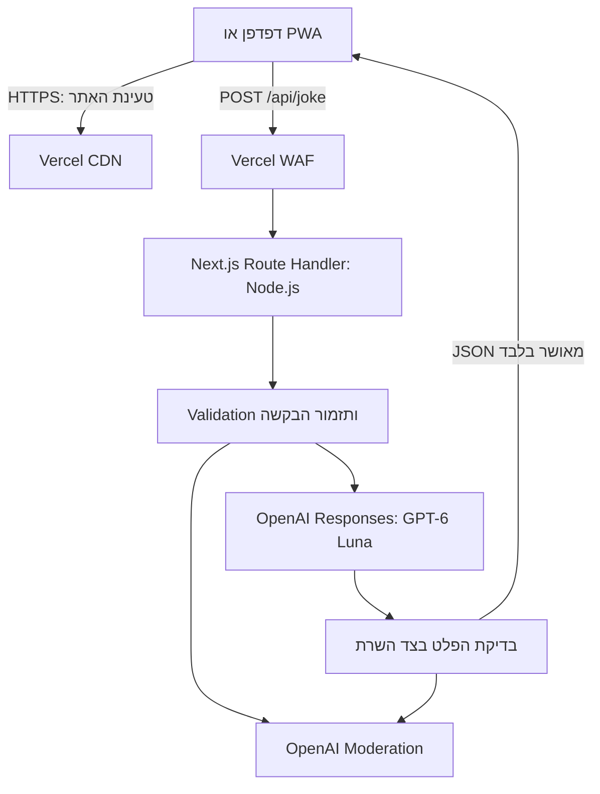

# ARCHITECTURE — אתר ליצירת בדיחות לפי נושא

תאריך המחקר: 21 באוקטובר 2026.

המסמך מבוסס על PRD.md ועל האישור בשיחה לבחור מודל נתמך אחר במקום GPT-5. ההחלטה במסמך זה היא להשתמש ב־GPT-6 Luna. זו הבהרה לדרישת המודל המקורית; יתר דרישות המוצר נשמרות. מסמך ה־PRD המקורי לא נערך במסגרת תוצר זה.

## 1. Technology Stack שנבחר

| רכיב | טכנולוגיה | תפקיד |
| --- | --- | --- |
| שפת פיתוח | TypeScript במצב strict | טיפוסים משותפים ל־Frontend ול־Backend ובדיקות בזמן Build |
| אפליקציית Web | Next.js 16, App Router, עם React בגרסה התואמת ל־Next.js | מסך המשתמש ו־HTTP API בפרויקט אחד |
| עיצוב | CSS Modules ו־Global CSS מצומצם | עיצוב Responsive, עברית ו־RTL ללא ספריית UI נוספת |
| Backend Runtime | Node.js 24 LTS | הרצת Route Handler בצד השרת |
| אינטגרציית AI | OpenAI SDK הרשמי ל־JavaScript/TypeScript, חבילת openai | פנייה ישירה מ־Backend ל־Responses API ול־Moderation API |
| יצירה ובדיקת תוכן | GPT-6 Luna, מזהה gpt-6-luna | יצירת בדיחה ובדיקה נפרדת של התאמה לדרישות |
| Moderation | omni-moderation-latest | סינון תוכן מזיק בקלט ובפלט כשכבת הגנה נוספת |
| PWA | Web App Manifest מובנה ב־Next.js, אייקונים ו־HTTPS | התקנה והפעלה במצב standalone במכשירים תומכים |
| Hosting | Vercel, עם Vercel Functions ו־Fluid Compute | הגשת נכסים סטטיים והרצת ה־Backend באותו Origin |
| הגנת תעבורה | Vercel WAF Rate Limiting | צמצום ניצול לרעה של ה־API ללא מסד נתונים באפליקציה |
| קוד ופריסה | GitHub וחיבור Git המובנה ב־Vercel | ניהול גרסאות, Preview Deployments ופריסה אוטומטית |
| נתונים | זיכרון זמני בלבד | נושא ובדיחה במהלך השימוש; אין Database או היסטוריה |

יש לקבע את גרסאות התלויות המדויקות ב־package-lock.json בעת יצירת הפרויקט ולהשתמש ב־npm ci. נבחרת גרסה יציבה ומתוקנת של Next.js 16, ללא Canary; גרסת React נלקחת לפי התאימות הרשמית של Next.js. Node.js 24.x נקבע גם בפרויקט וגם ב־Vercel. זו גרסת LTS הנתמכת בשירות. [Next.js Installation](https://nextjs.org/docs/app/getting-started/installation), [Vercel Node.js Versions](https://vercel.com/docs/functions/runtimes/node-js/node-js-versions).

### 1.1 נימוקי הבחירה

**Frontend ו־Backend משולבים:** נבחנו Next.js עם Route Handlers, React עם Vite ו־Backend נפרד, ו־Vue עם Vite ו־Backend נפרד. שלושתן חלופות תקפות למסך קטן. Next.js נבחר משום שהמוצר מחייב Backend לשמירת המפתח, והוא מרכז פיתוח מקומי, Build ופריסה בפרויקט אחד. אין צורך בשרת Express נוסף. React מציג את Next.js כאפשרות Full-stack מוכרת, ו־Next.js מספק HTTP Route Handlers ותיעוד PWA ייעודי. הבחירה מבוססת על התאמת האינטגרציה, ולא על צורך ב־SSR לכל פעולה. [React](https://react.dev/learn/creating-a-react-app), [Route Handlers](https://nextjs.org/docs/app/getting-started/route-handlers), [Vite](https://vite.dev/guide/), [Vue](https://vuejs.org/guide/quick-start.html).

**עיצוב:** נבחנו CSS Modules ו־Tailwind CSS. עבור טופס אחד ואזור תוצאה, CSS Modules מספקים בידוד סגנונות ותמיכה ישירה של Next.js עם מעט תלויות. אין צורך ב־Design System או בספריית Components. [Next.js CSS](https://nextjs.org/docs/app/getting-started/css).

**Hosting:** נבחנו Vercel, Netlify ו־Cloudflare Workers. לכולן יכולות Hosting והרצת Backend. Vercel נבחר בהתאם להעדפת המשתמש, לחיבור הישיר ל־GitHub ולתמיכה ב־Next.js וב־Node.js. Netlify משתמשת במודל Credits; Cloudflare Workers היא חלופה זולה, אך מעבר ל־Runtime ולאינטגרציית הפריסה שלה אינו מוסיף ערך נדרש למוצר זה. [Vercel GitHub](https://vercel.com/docs/git/vercel-for-github), [Netlify Pricing](https://www.netlify.com/pricing/), [Cloudflare Workers Pricing](https://developers.cloudflare.com/workers/platform/pricing/).

**AI:** לאחר האישור להחליף את GPT-5 נבחנו GPT-6 Luna, GPT-5.6 Luna ו־GPT-6 Sol. GPT-6 Luna נבחר משום שהיצרן מייעד אותו למשימות ממוקדות בנפח גבוה, הוא תומך ב־Structured Outputs ועלותו נמוכה. Sol מכוון לעבודה מורכבת יותר, ואין הצדקה ראשונית לעלות שלו עבור בדיחה קצרה. זו בחירה תכנונית; לא נערך Benchmark של הומור בעברית ולא נמדדה איכות בפועל. אין הבטחה למשך תמיכה עתידי של מודל כלשהו. [GPT-6 Luna](https://developers.openai.com/api/docs/models/gpt-6-luna), [GPT-5.6 Luna](https://developers.openai.com/api/docs/models/gpt-5.6-luna), [GPT-6 Sol](https://developers.openai.com/api/docs/models/gpt-6-sol).

**SDK:** נבחנו OpenAI SDK ו־Vercel AI SDK. נבחר SDK הספק משום שנדרשים ספק אחד, יצירה אחת ו־Moderation, ללא Chat, Agents או מעבר דינמי בין ספקים. הוא חוסך שכבת התאמה נוספת ומאפשר טיפול מפורש במצבי השגיאה. [OpenAI SDKs](https://developers.openai.com/api/docs/libraries), [Vercel AI SDK](https://ai-sdk.dev/docs/introduction).

**PWA:** נבחנו Manifest מובנה ללא Offline Cache, לעומת פתרון עם Service Worker ו־Workbox. נבחר הפתרון הראשון: ההתקנה אינה מחייבת Service Worker בדפדפנים המתוארים ב־MDN, ויצירה ללא חיבור אינה דרישה. אין הצדקה לתוסף Cache נוסף. [Next.js PWA](https://nextjs.org/docs/app/guides/progressive-web-apps), [MDN Installability](https://developer.mozilla.org/en-US/docs/Web/Progressive_web_apps/Guides/Making_PWAs_installable).

לא נבחרו Database, Authentication Provider או אחסון קבצים חיצוני: אין במוצר מידע מתמשך, חשבונות או העלאת קבצים. אייקונים וקובצי PWA הם נכסי הפרויקט ונפרסים יחד איתו.

### 1.2 עלויות ומגבלות

- Vercel Hobby עולה $0 ומיועד לשימוש אישי לא מסחרי, בכפוף למכסות. אין להסיק שהמוצר זכאי לתוכנית זו רק משום שהוא קטן. אם השימוש מסחרי נדרשת תוכנית מתאימה; Pro מוצגת במחיר בסיס של $20 לחודש, עם Usage Credit של $20 וחיובי שימוש נוספים בהתאם לתוכנית. לא הוגדר שימוש מסחרי או תקציב, ולכן אין כאן התחייבות לרכישה או להוצאה קבועה. [Vercel Pricing](https://vercel.com/pricing), [Hobby](https://vercel.com/docs/plans/hobby).
- מגבלות Fluid Compute העדכניות הן עד 300 שניות ב־Hobby ועד 800 שניות ב־Pro ללא הסתמכות על Beta. התכנון משתמש ב־maxDuration של 60 שניות וב־Deadline פנימי קצר יותר, ולכן מתאים לשתיהן. זמני המתנה ל־AI אינם Active CPU, אך זמן הזיכרון המוקצה עדיין עשוי להיות מחויב. [Functions Limits](https://vercel.com/docs/functions/limitations).
- מחיר Standard ל־GPT-6 Luna בהקשר קצר הוא $0.10 למיליון Input Tokens ו־$0.50 למיליון Output Tokens. לצורך המחשה בלבד, 1,000 Input Tokens ו־250 Output Tokens בסך כל קריאות היצירה והבדיקה לבקשה עולים כ־$0.000225, כלומר כ־$2.25 ל־10,000 בקשות. זהו חישוב לפי הנחת נפח, ולא תחזית שימוש; הוא אינו כולל Cache Writes, שירותי Hosting, מסים או עלויות של בקשות שנכשלו. [OpenAI Pricing](https://developers.openai.com/api/docs/pricing).
- Moderation API מוצג כשירות ללא עלות. הוא אינו מכסה לבדו את כל כללי „לכל המשפחה”, ובפרט אינו מסנן באופן מלא קללות או כל הומור פוגעני. [Moderation](https://developers.openai.com/api/docs/guides/moderation).
- WAF Rate Limiting זמין בכל התוכניות. ב־Hobby קיימת מכסה של כלל Rate Limiting אחד ומיליון בקשות מותרות כלולות; המחיר המוצג לשימוש מחויב הוא $0.50 למיליון בקשות מותרות, בהתאם לאזור. [WAF Rate Limiting](https://vercel.com/docs/vercel-firewall/vercel-waf/rate-limiting).
- ללא חשבונות או Database, אין מכסה אמינה לכל אדם, מניעת כפילויות גלובלית או הבטחה לייחודיות הבדיחות. חסימה לפי IP עלולה להשפיע על משתמשים באותה רשת ואינה עוצרת מתקפה מבוזרת.

## 2. ארכיטקטורת המערכת

### 2.1 מבנה ואחריות



זוהי אפליקציה אחת עם הפרדה לוגית פנימית, ללא Microservices. ה־Frontend אינו מכיר את פרטי ההתחברות ל־OpenAI ואינו מקבל תוצאות ביניים מהמודל.

| Module | אחריות |
| --- | --- |
| Presentation | תיבה, לחצן, בדיחה והודעות בעברית; State מקומי |
| API Boundary | קבלת HTTP, אימות Origin, גודל וסוג הקלט, Response Contract ומיפוי שגיאות |
| Joke Service | תזמור סדר הסינון, היצירה ובדיקת הפלט תחת Deadline אחד |
| Content Policy | כללי התוכן מה־PRD והכרעת דחייה; הנחיות נפרדות ליצירה ולבדיקה |
| OpenAI Adapter | SDK, מודל קבוע בשרת, Structured Outputs, Timeouts וטיפול בספק |
| Configuration | Environment Variables, סודות, מגבלות והגדרות סביבה |

התלויות זורמות מה־API אל השירות ואל ה־Adapter. קוד OpenAI והסודות מסומנים server-only ואינם מיובאים מ־Client Components. חוזי נתונים משותפים לא כוללים קוד שרת או Secrets.

### 2.2 Frontend ומצבי ממשק

המסך הראשי מוצג בנתיב `/`. מעטפת העמוד יכולה להיבנות מראש; הטופס והתגובה ממומשים ב־Client Component קטן. אין צורך ב־Redux, בספריית Forms, ב־Client Router נוסף או ב־Query Cache.

מצבי הממשק: `idle`, `loading`, `success`, `rejected`, `error`.

- העמוד מוגדר `lang="he"` ו־`dir="rtl"`. משתמשים ב־CSS Logical Properties, ברוחב גמיש וב־viewport מותאם למובייל.
- תווית התיבה „נושא לבדיחה” והלחצן „צרו בדיחה” הם הנוסחים המוצעים ב־PRD.
- שליחה תקפה יוצרת Snapshot של הנושא. במהלך הבקשה התיבה והלחצן מושבתים, כדי שהבדיחה שתתקבל תתאים לנושא המוצג. זו החלטת מימוש למניעת Race Conditions.
- מוצג „מכינים לכם בדיחה…”. הלחצן מושבת גם לוגית כדי למנוע שליחה כפולה באותו עמוד.
- בתחילת בקשה חדשה מוסרת הבדיחה הישנה; בהצלחה מוצגת בדיחה אחת בלבד. אין שליחה אוטומטית עם טעינת העמוד או בשינוי התיבה.
- בסיום כל בקשה, כולל כשל, השליטה חוזרת למשתמש. הנושא נשמר ב־State הנוכחי לצורך ניסיון נוסף.
- דחיית נושא מציגה „בחרו נושא שמתאים לכל המשפחה”. כל כשל אחר מציג „לא הצלחנו ליצור בדיחה. נסו שוב”.
- גם כשל HTTP שאינו JSON, חסימת WAF או Timeout בפלטפורמה ממופים בלקוח להודעת הכשל. אין הצגת Stack Trace או הודעת ספק.
- תוצאת AI מוצגת כטקסט רגיל, ללא HTML או Markdown פעיל. משתמשים ב־label תקין, Focus נראה ו־aria-live לחיווי ותוצאה.

### 2.3 PWA

Manifest מוגש באמצעות התמיכה המובנית של Next.js וכולל `start_url: "/"`, `scope: "/"`, `display: "standalone"`, `lang: "he"`, `dir: "rtl"`, שם בעברית ואייקונים של 192×192 ו־512×512. מוגדר גם apple-touch-icon. **הנחת מימוש:** עד לבחירת שם מוצר, שם ההתקנה הוא „בדיחות”.

האתר מוגש ב־HTTPS. משתמשים במנגנון ההתקנה של הדפדפן; ב־iOS ההתקנה נעשית דרך תפריט השיתוף והוספה למסך הבית. אין הבטחה ל־Install Prompt אחיד בכל דפדפן. יעדי האימות המוצעים הם Chrome ב־Android ו־Safari ב־iOS; אלה יעדי בדיקה טכניים, לא הרחבת התחייבות התמיכה ב־PRD.

לא מוגדר Service Worker, Offline Cache או Background Sync. האפליקציה דורשת חיבור ליצירה; אין אגירת בקשות לשליחה מאוחרת ואין שמירת בדיחות ב־Cache. קיום התקנה אינו מבטיח שניתן לטעון את האתר ללא רשת. [MDN](https://developer.mozilla.org/en-US/docs/Web/Progressive_web_apps/Guides/Making_PWAs_installable).

### 2.4 Data Model ושמירת נתונים

| מבנה זמני | שדות | משך חיים |
| --- | --- | --- |
| Client State | topic, status, joke, errorCode | זיכרון העמוד בלבד |
| Joke Request | topic | משך בקשת HTTP |
| Generation Result | status, joke | זיכרון ה־Backend עד לאישור או דחייה |
| Review Result | topicAllowed, jokeAllowed, hebrew, relevant | זיכרון ה־Backend בלבד |
| Operational Event | requestId, statusCode, errorCode, durationMs, tokenCounts | לוג תפעולי ללא תוכן משתמש |

כל בקשה עצמאית. אין User Entity, Session, Conversation, קשרים מתמשכים בין בקשות או Database Migrations. לא נשמרים נושא או בדיחה ב־localStorage, ב־sessionStorage, ב־IndexedDB או בקובצי שרת. רענון מאפס את המידע. התקנת ה־PWA ומטמון הנכסים הסטטיים מנוהלים בידי הדפדפן ואינם היסטוריית מוצר.

הלוג התפעולי אינו מסד נתוני מוצר. הוא אינו כולל Request Body, נושא, בדיחה, Authorization Headers או תגובת SDK גולמית. מסנני התעבורה של ספק ה־Hosting עשויים לעבד IP ומטא־נתונים לצורכי תפעול ואבטחה; „ללא Database” אינו אומר שאין עיבוד מידע אצל הספקים.

### 2.5 API Contract

הממשק היחיד ליצירה הוא `POST /api/joke`, באותו Origin, עם `Content-Type: application/json`.

```json
{ "topic": "כלבים" }
```

**ברירות מחדל טכניות:** Body עד 4 KiB ונושא עד 200 Unicode Code Points לאחר trim ו־NFC normalization. אין חיתוך שקט של טקסט ארוך. אלה מגבלות הגנה לממשק נושא קצר, ולא דרישות מוצר שהוגדרו ב־PRD. ההגבלה מוצגת באמצעות `maxLength` שמרני בתיבה ונאכפת בשרת; יש להקפיד שבדיקת השרת היא הסמכות. רווחים בלבד מטופלים כנושא ריק. שדה חסר שקול לריק; null, מספר או מבנה אחר אינם נושא תקף. מגבלת ה־Body נאכפת גם כאשר אין Content-Length תקין.

| HTTP | קוד אפליקטיבי | משמעות |
| --- | --- | --- |
| 200 | — | הצלחה: `{ "joke": "..." }` |
| 422 | TOPIC_NOT_ALLOWED | נושא שנדחה לפי כללי התוכן |
| 400 | INVALID_REQUEST | JSON או מבנה לא תקינים, או נושא ארוך מהמותר |
| 403 | FORBIDDEN_ORIGIN | בקשה שאינה עומדת בבדיקות ה־Origin |
| 405 | METHOD_NOT_ALLOWED | מתודה שאינה POST |
| 413 | PAYLOAD_TOO_LARGE | Body גדול מהמותר |
| 415 | UNSUPPORTED_MEDIA_TYPE | סוג תוכן שאינו JSON |
| 429 | RATE_LIMITED | חריגה מהגבלת תעבורה |
| 502 | GENERATION_FAILED | פלט לא תקין, פלט שנפסל או כשל ספק |
| 503 | SERVICE_UNAVAILABLE | הגדרות חסרות, מכסה או זמינות שירות |
| 504 | GENERATION_TIMEOUT | חריגה מה־Deadline |

תגובה אפליקטיבית לשגיאה היא `{ "error": { "code": "TOPIC_NOT_ALLOWED" } }`. ה־Frontend מחזיק את נוסחי ההודעות בעברית. אין להסתמך על מבנה JSON זה לשגיאות שנוצרות מחוץ לאפליקציה ב־WAF או בפלטפורמה.

כל תגובות הנתיב מוגדרות `Cache-Control: no-store`; אין CDN Cache, Deduplication או החזרת בדיחה קודמת. לחיצה נוספת מפעילה יצירה חדשה, אך לא מובטחת בדיחה שמעולם לא הופיעה.

### 2.6 Data Flow וסינון התוכן

1. ה־WAF מגביל את קצב הפניות לפני הפעלת ה־Function.
2. ה־API מאמת Origin, מתודה, Media Type, גודל ומבנה. מתבצע נרמול הנושא; תיבה ריקה אינה שגיאה.
3. לנושא שאינו ריק מתבצעת בדיקת Moderation. נושא שנפסל מקבל `TOPIC_NOT_ALLOWED`, ללא יצירה.
4. ה־Backend שולח ל־Responses API הוראות שרת קבועות: בדיחה קצרה בעברית בלבד, קשורה לנושא, ללא תוכן מיני, קללות, אלימות או הומור פוגעני. קלט המשתמש נשלח כנתון נפרד, ללא שילוב בהוראות המערכת. אין Tools, גלישה או גישה למשאבים אחרים.
5. תשובת היצירה נדרשת לעמוד ב־JSON Schema קשיח: `status` הוא `ok` או `rejected`, ו־`joke` הוא string. במקרה `rejected`, `joke` חייב להיות ריק. המודל נדרש להכריע בהתאמת הנושא לפני כתיבת בדיחה, משום ש־Moderation אינו מכסה לבדו את מדיניות המוצר.
6. `rejected` או Safety Refusal מפורש ביצירה ממופים לדחיית נושא; אין להציג למשתמש את טקסט הסירוב של המודל. Timeout, JSON פגום, Incomplete או היעדר בדיחה אינם דחיית נושא ונחשבים כשל.
7. בדיחה מועמדת נבדקת ב־Moderation ובקריאת Responses נפרדת לבדיקת התוכן. ניתן להפעיל את שתי הבדיקות במקביל. הבדיקה השנייה מקבלת את הנושא והבדיחה כנתונים ומחזירה רק Booleans: התאמת הנושא לילדים, עמידת הבדיחה בכללי המשפחה, עברית ורלוונטיות לנושא. כאשר הנושא ריק, הרלוונטיות נחשבת לבדיחה כללית.
8. אם הבדיקה מזהה נושא לא מתאים, מוחזרת דחיית נושא. אם הנושא מתאים אך הבדיחה נפסלת, מוחזר `GENERATION_FAILED`. כל כשל, סירוב או עמימות בבדיקת הפלט חוסמים את הצגת הבדיחה.
9. רק לאחר אישור כל הבדיקות מוחזר טקסט הבדיחה ללקוח. אין Streaming של הפלט, משום שאין להציג תוכן לפני שעבר סינון.

הקריאות ל־Responses משתמשות ב־`model: "gpt-6-luna"`, ב־`store: false`, ב־`reasoning.effort: "low"` וב־Structured Outputs עם `strict: true` ו־`additionalProperties: false`. נקבע `max_output_tokens` של 1,024 ליצירה ו־512 לבדיקה כערכי התחלה טכניים; Reasoning צורך מאותה מכסה, ותגובה שנקטעה אינה מוצגת. לא נשלחים `temperature` או `top_p` עם הגדרת Reasoning זו. אין שימוש ב־previous_response_id או ב־Conversations. [Using GPT-6](https://developers.openai.com/api/docs/guides/latest-model), [Structured Outputs](https://developers.openai.com/api/docs/guides/structured-outputs).

בדיקת Schema נאכפת גם בשרת; המבנה אינו מוכיח שהבדיחה מתאימה לילדים. גם שילוב Moderation ובדיקה נפרדת אינו מבטיח אפס טעויות, ובדיקות באותו מודל עשויות לחלוק טעויות. נדרש אימות עם דוגמאות בעברית, קלט בשפות אחרות וניסיונות Prompt Injection. אין להציג את המוצר כמערכת עם הבטחת סינון מוחלטת.

### 2.7 זמני ריצה, שגיאות ואמינות

**ערכי התחלה טכניים, ללא התחייבות SLA:** Deadline של 45 שניות לכל התזמור, `maxDuration = 60` ל־Function ו־Client Timeout של 55 שניות. כל קריאה מקבלת Abort Signal מה־Deadline המשותף ומכסה לפי הזמן שנותר. הלקוח אינו נשאר ב־loading ללא סוף.

מגדירים ב־SDK `maxRetries: 0` כדי למנוע הכפלת קריאות וזמן המתנה באופן סמוי. אין Retry אוטומטי של הבקשה בלקוח או ב־Backend, ואין יצירה חוזרת כאשר הפלט נפסל. המשתמש יכול לנסות שוב בלחיצה. ביטול מקומי או ניתוק לקוח אינם מבטיחים שבקשה שכבר התקבלה אצל הספק לא תחויב.

אין Queue, Cron, WebSocket או תהליך רקע. ה־Backend הוא Stateless ומתאים ל־Serverless Scaling. הגדילה מוגבלת גם ב־Rate Limits ובתקציב OpenAI; הוספת מופעי Vercel אינה מגדילה את מכסת הספק. קודי 401, 429 ו־5xx של OpenAI ממופים לשגיאות האפליקטיביות ולוג תפעולי מסונן.

### 2.8 Authentication, אבטחה ופרטיות

אין הרשמה, Login, Roles או הרשאות אישיות, בהתאם להיקף המוצר. ה־API ציבורי ומאפשר רק את פעולת היצירה הקבועה; המשתמש אינו בוחר מודל, Prompt, מספר Tokens או כתובת ספק.

- OPENAI_API_KEY זמין אך ורק ב־Backend. הוא אינו משתמש בקידומת NEXT_PUBLIC_, אינו נכתב לקוד או ל־Git ואינו מוחזר ללקוח.
- ה־Adapter אינו מאפשר dangerousAllowBrowser. נעשה שימוש במפתח Project ייעודי ובהרשאות המצומצמות הדרושות.
- בקשות דפדפן מוגבלות ל־Origin המדויק של הסביבה; אין CORS עם wildcard. נדרש Origin תואם, ואם קיים Sec-Fetch-Site הוא חייב להתאים לאותה סביבה. Origin חסר נדחה. בדיקה זו מצמצמת שימוש מאתרים אחרים אך אינה Authentication ואינה מונעת לקוח זדוני מזיוף Headers.
- מוגדר כלל WAF עבור POST בנתיב `/api/joke`, עם Fixed Window לפי IP. ערך פתיחה מוצע: 10 בקשות לדקה. זו בקרת תשתית ניתנת לכוונון, לא מכסת מוצר מאושרת. אין להסתמך על Map בזיכרון Function כ־Rate Limiter גלובלי. מוני Vercel הם אזוריים, ולכן אין כאן תקרת שימוש גלובלית מוחלטת.
- HTTPS נדרש בכל הסביבות הציבוריות. מגדירים Content Security Policy בהתאם לנכסי Next.js, חסימת Framing, X-Content-Type-Options ו־Referrer-Policy. אין Analytics או Scripts של צד שלישי ללא צורך מוצר שהוגדר.
- שומרים לוגים תפעוליים ללא נושא או בדיחה, ומוודאים ששגיאות SDK אינן מדפיסות Body או Secrets.

**קהל הכולל ילדים:** אין צורך לאסוף שם, גיל או מזהה משתמש. עם זאת, תיבה חופשית עלולה להכיל מידע אישי גם ללא שדות ייעודיים. לפי הנחיות OpenAI, עיבוד מידע אישי של ילדים מתחת לגיל 13 או גיל ההסכמה הדיגיטלית הרלוונטי מחייב תחילה Zero Data Retention. לצורך תכנון שמרני של המוצר כפי שהוגדר, הפעלה ציבורית לקהל זה תלויה בהסדרת ZDR עבור פרויקט OpenAI והמודל הנבחר, ובהתאמה להנחיות הספק. זו תלות ספק שיש לאמת, ולא יכולת מוצר נוספת או אישור שכבר התקבל. אם ההסדר אינו זמין, אין להניח ש־store:false או העדר Database פותרים זאת; נדרשת הכרעת מוצר נפרדת לפני הפעלה כזו. [Under-18 Guidance](https://developers.openai.com/api/docs/guides/safety-checks/under-18-api-guidance).

`store:false` מצמצם שמירת Application State, אך אינו שקול ל־ZDR. בברירת המחדל עשויים להישמר Abuse Monitoring Logs עד 30 יום; שינוי בקרות השמירה כפוף לאישור ולתנאי הספק. אין במסמך הבטחה לאי־שמירה מוחלטת אצל OpenAI או Vercel. [Data Controls](https://developers.openai.com/api/docs/guides/your-data).

### 2.9 Configuration וסביבות

| הגדרה | Development | Preview | Production |
| --- | --- | --- | --- |
| OPENAI_API_KEY | מפתח פיתוח ב־.env.local שאינו ב־Git | מפתח פיתוח נפרד או מוגבל, ב־Vercel | מפתח Production ב־Vercel בלבד |
| OPENAI_MODEL | gpt-6-luna | gpt-6-luna | gpt-6-luna |
| APP_ORIGIN | כתובת localhost מדויקת | Origin של ה־Preview Deployment | הדומיין הציבורי הקבוע |
| GENERATION_ENABLED | true לפי צורך | true לבדיקות מורשות | true; false מאפשר עצירת יצירה תפעולית |

API Key של Production אינו מועתק למחשב פיתוח, ל־Preview או ל־GitHub. Preview לא מהימן מ־Fork אינו מקבל Secrets. ZDR והגבלות הפרויקט מוגדרים בשירות OpenAI עצמו ואינם מופעלים באמצעות Environment Variable באפליקציה. קובץ .env.example כולל שמות בלבד, ללא ערכים סודיים. [Vercel Environment Variables](https://vercel.com/docs/environment-variables).

שינוי Environment Variables מחייב Deployment חדש כדי שיחול על הגרסה הרלוונטית. WAF, Billing ובקרות שמירת נתונים הן הגדרות שירות; הן אינן חלק אוטומטי מה־Git Deployment ויש לוודא שהן מוגדרות בסביבות המתאימות.

### 2.10 GitHub, Build ו־Deployment

קוד המקור מנוהל ב־Git Repository יחיד ב־GitHub. Repository פרטי הוא ברירת מחדל תפעולית; אין צורך ב־Monorepo Tool. קובצי המקור, נכסי PWA, Prompt Templates, חוזי API ו־Lockfile נשמרים בו. Secrets, .env.local ו־Build Outputs מוחרגים.

מחברים את ה־Repository לפרויקט Vercel ומגדירים את `main` כ־Production Branch:

1. Push לענף עבודה או Pull Request מפעיל Build ויוצר Preview Deployment.
2. ה־Build מתקין באמצעות npm ci ומריץ Type Checking, בדיקות חוזה וסינון עם Mocks, ואת next build. פקודת Build הכוללת את הבדיקות נכשלת אם בדיקה חיונית נכשלת, כך שלא יפורסם Build לא תקין.
3. Merge ל־main מפעיל Production Deployment אוטומטי, עם משתני Production בלבד. נכסים סטטיים מוגשים דרך CDN וה־Route Handler נפרס כ־Node.js Function.
4. בדיקות CI אינן שולחות טקסט אמיתי ל־AI ואינן דורשות מפתח Production. בדיקות איכות חיות משתמשות בסביבת פיתוח, בקלט סינתטי ובהוצאות מבוקרות.
5. במקרה תקלה אפשר להחזיר Deployment קודם ב־Vercel. אין נתוני מוצר או Database Migrations לשחזור. הגדרות Firewall ו־Secrets אינן משוחזרות בהכרח עם גרסת הקוד.

התהליך מתאר את מנגנון הפריסה הקבוע, ואינו רשימת שלבי פיתוח. אין צורך בפריסה ידנית בכל עדכון. [Vercel for GitHub](https://vercel.com/docs/git/vercel-for-github).

### 2.11 אימות התאמה ל־PRD

| דרישה | מענה ארכיטקטוני |
| --- | --- |
| נושא אופציונלי ובדיחה בנושא | POST עצמאי עם topic מנורמל; נושא ריק מפעיל יצירה כללית |
| בדיחה חדשה בלחיצה | ללא Cache לתוצאות, ללא היסטוריה ובדיחה אחת ב־State |
| עברית ו־RTL | מעטפת he/rtl, נוסחים קבועים ובדיקת פלט בעברית |
| תוכן מתאים לילדים | Moderation, הוראות יצירה ובדיקת פלט נפרדת לפני שליחה ללקוח |
| נושא לא מתאים | קוד TOPIC_NOT_ALLOWED ללא החלפה אוטומטית לבדיחה כללית |
| המתנה ושגיאות | State מוגדר, לחצן מושבת, Deadline והודעות מאושרות |
| PWA ושימוש עם חיבור | Manifest, אייקונים, HTTPS והתקנה בדפדפנים תומכים |
| AI רק ב־Backend | OpenAI Adapter server-only ומפתח בסביבת השרת |
| ללא Database | מידע זמני בלבד; ללא Sessions, היסטוריה או אחסון תוכן |

האימות הנדרש במימוש כולל קלט ריק ורווחים, נושא בעברית ובשפה אחרת, נושא אסור, Prompt Injection, פלט מזיק או פגום, Refusal, פלט שנקטע, 429, Timeout, אובדן חיבור ולחיצה כפולה. יש לבדוק שהמפתח אינו מופיע ב־Client Bundle ושבקשת AI אינה יוצאת מהדפדפן. יש לאמת התקנה ופתיחה של PWA במכשירי היעד, ונגישות בסיסית של הטופס וההודעות. מחקר התיעוד אינו תחליף לבדיקות אלו; במסגרת הכנת המסמך לא נבנתה אפליקציה ולא בוצעו קריאות AI בתשלום.
