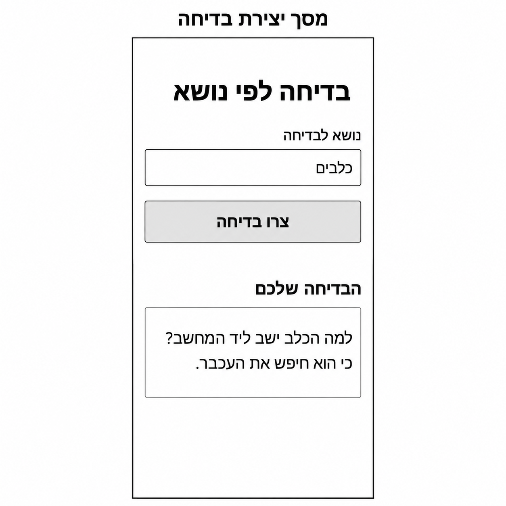
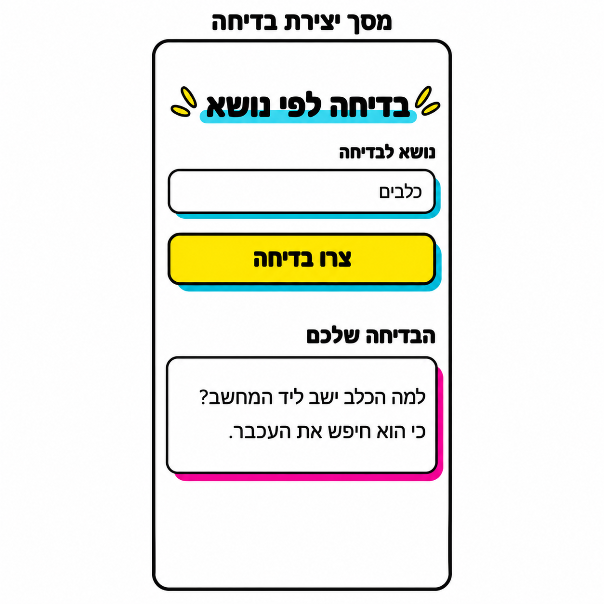
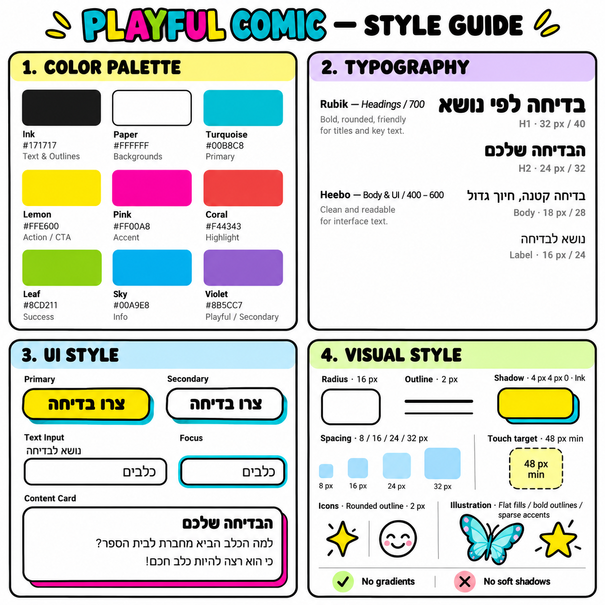

# DESIGN — עיצוב האפליקציה ליצירת בדיחות

המסמך מתרגם את מקורות העיצוב להנחיות מימוש: ה־PRD קובע התנהגות ואילוצי UX, ה־Wireframes קובעים מבנה ותוכן, ה־Style Guide קובע את השפה החזותית, וה־Mockups קובעים את הופעת המסך הסופית. המסמך אינו משנה דרישות מוצר.

## 1. Screens — מסכי האפליקציה

### 1.1 מסך יצירת בדיחה

זהו המסך היחיד באפליקציה. ה־Wireframe וה־Mockup מציגים אותו לאחר יצירת בדיחה, עם נושא מלא ותוצאה אחת.

**מטרת המסך:** הזנת נושא, הפעלת יצירת בדיחה וקריאת התוצאה, באותו מקום.

**מבנה ותוכן:** עמוד אנכי בעל רקע צבעוני (Cream עם קונפטי, ראה 2.2), עם טור תוכן מרכזי המותאם למובייל. סדר הרכיבים מלמעלה למטה:

| רכיב | תוכן והצבה |
| --- | --- |
| כותרת ראשית | „בדיחה לפי נושא”, בחלק העליון, במרכז טור התוכן |
| תווית שדה | „נושא לבדיחה”, מעל השדה וביישור לימין |
| שדה טקסט | שדה יחיד ברוחב הטור. בתמונות מופיע הערך „כלבים”, מיושר לימין |
| לחצן ראשי | „צרו בדיחה”, מתחת לשדה, ברוחב הטור ובטקסט ממורכז |
| כותרת אזור התוצאה | „בדיחה יומית” לפני הבדיחה הראשונה; „הבדיחה שלכם” לאחריה. ביישור לימין, לאחר מרווח בולט מהלחצן |
| כרטיס תוצאה | בדיחה אחת או הודעת מצב, בטקסט מיושר לימין, בתוך כרטיס ברוחב הטור |

תוכן הדוגמה בכרטיס ה־Wireframe וה־Mockup הוא:

> למה הכלב ישב ליד המחשב?
>
> כי הוא חיפש את העכבר.

זהו תוכן המחשה בלבד, ולא בדיחה קבועה או Placeholder. גם „כלבים” הוא ערך הדוגמה בתמונות ואינו ברירת מחדל שנקבעה למוצר.

**פעולות וניווט:** המשתמש עורך את הנושא ומפעיל את הלחצן. יצירה נוספת וקריאת הבדיחה נשארות באותו מסך. התנהגות של נושא ריק, המתנה, דחייה וכשל מוגדרת ב־PRD; אלה מצבים של המסך היחיד, ללא ניווט למסכים נוספים.

**מימוש חזותי של מצבים:** כל המצבים מוצגים בתוך אותו כרטיס תוצאה, באותו עיצוב (Paper, קו Ink, צל Pink), ללא Spinner, Toast, Modal, Animation או צבעי מצב חדשים. אין להחליף את נוסחי ההודעות שאושרו.

| מצב | כותרת מעל הכרטיס | תוכן הכרטיס |
| --- | --- | --- |
| פתיחה (לפני בדיחה ראשונה) | „בדיחה יומית” | ריק. הכרטיס שומר על גובה מינימלי של כשתי שורות Body, כדי שלא יקרוס |
| המתנה | ללא שינוי | „מכינים לכם בדיחה…” בטקסט Body |
| הצלחה | „הבדיחה שלכם” | הבדיחה |
| דחיית נושא | ללא שינוי | „בחרו נושא שמתאים לכל המשפחה” בטקסט Body |
| כשל | ללא שינוי | „לא הצלחנו ליצור בדיחה. נסו שוב” בטקסט Body |

„ללא שינוי” פירושו שהכותרת נשארת כפי שהייתה: „בדיחה יומית” אם עוד לא הוצגה בדיחה, אחרת „הבדיחה שלכם”.

**מצב מושבת (בזמן המתנה):** הלחצן והשדה נשארים באותם צבעים, ב־`opacity: 0.6`, עם `cursor: not-allowed`. הצל הקשיח נשאר.

**Focus:** היקף Turquoise בעובי `3px` מחוץ לקו המתאר (`outline-offset: 2px`), גם לשדה וגם ללחצן, רק בניווט מקלדת (`:focus-visible`) בלחצן, ותמיד בשדה.

#### Wireframes — מקור המבנה

#### Mockups — המראה הסופי

**גבולות התמונה לעומת האפליקציה:** הכיתוב „מסך יצירת בדיחה” מעל המסגרת הוא שם המסך בלוח התיעוד, ואינו כותרת נוספת בתוך האפליקציה. המסגרת החיצונית והשוליים שמחוץ לה מסמנים את ה־Viewport בלוח; אין לממש אותם כ־Device Frame או כשוליים קבועים באתר. הכותרת הפנימית היא „בדיחה לפי נושא”.

### 1.2 מבנה הניווט הכללי

האפליקציה כוללת מסך אחד, ללא מעברים פנימיים בין עמודים. לא מופיעים במקורות תפריט, Tab Bar, סרגל ניווט, Sidebar או Footer. פתיחת האתר ופתיחת ה־PWA מובילות לאותו ממשק; לא מוגדר מסך התקנה נפרד. הכותרת בלשונית הדפדפן היא „בדיחה לפי נושא”.

## 2. Style Guide — השפה העיצובית

### 2.1 כיוון חזותי

השפה היא Playful Comic: צבעים חיים על רקע Cream צבעוני וילדותי עם קונפטי, טקסט כהה ובולט, קווי מתאר שחורים, פינות מעוגלות וצללים קשיחים בהיסט. האווירה קלילה וידידותית לכל המשפחה, אך הטופס נשאר פשוט וקריא.

ה־Mockup משתמש בפועל בעיקר בלבן, Ink, Lemon, Turquoise ו־Pink. אין צורך לשלב במסך את כל צבעי הפלטה. קישוטים נשארים משניים לטופס ולבדיחה.

### 2.2 Color Palette

קודי ה־HEX להלן מופיעים ב־Style Guide. הם ערכי המימוש; אין לדגום מחדש צבעים מהתמונות, שעשויות לכלול הבדלי רינדור.

| שם | HEX | שימוש עיצובי |
| --- | --- | --- |
| Ink | `#171717` | טקסט, קווי מתאר והדגשות כהות |
| Paper | `#FFFFFF` | רקע השדה והכרטיס |
| Cream | `#FFF8CC` | רקע העמוד וטור התוכן; עליו דוגמת הקונפטי |
| Turquoise | `#00B8C8` | הדגשה מתחת לכותרת, צל קשיח לשדה וללחצן, והיקף Focus |
| Lemon | `#FFE600` | מילוי הלחצן הראשי וסימני הדגשה ליד הכותרת |
| Pink | `#FF00A8` | צל קשיח לכרטיס הבדיחה |
| Coral | `#F44343` | צבע Highlight בפלטה; אינו משויך לרכיב במסך הסופי |
| Leaf | `#8CD211` | מופיע בפלטה עם תווית Success; אינו מגדיר חיווי הצלחה במוצר |
| Sky | `#00A9E8` | מופיע בפלטה עם תווית Info; אינו משויך לרכיב במסך הסופי |
| Violet | `#8B5CC7` | צבע משני בפלטה; אינו משויך לרכיב במסך הסופי |

טקסט השדה, הכרטיס והלחצן נשאר Ink. אין ב־Mockup טקסט לבן על משטחים בצבעים בהירים, ואין צורך להוסיף שילוב כזה.

### 2.3 Typography

ה־Style Guide מגדיר את משפחות הגופנים וההיררכיה הבאות. הגדלים הם ערכי UI מומלצים ב־CSS px, ולא מידות הפיקסלים של תמונת הלוח המוגדלת.

| שימוש | משפחה | משקל | Font Size / Line Height | יישור |
| --- | --- | --- | --- | --- |
| H1 — „בדיחה לפי נושא” | Rubik | 700 | `32px / 40px` | מרכז |
| H2 — „בדיחה יומית” / „הבדיחה שלכם” | Rubik | 700 | `24px / 32px` | ימין |
| Body — טקסט הבדיחה, הודעות המצב והשדה | Heebo | 400 | `18px / 28px` | ימין |
| Label — „נושא לבדיחה” | Heebo | 600 | `16px / 24px` | ימין |
| Button — „צרו בדיחה” | Rubik | 700 | `20px / 28px` | מרכז |

הטקסט בלחצן עבה ומעוגל, כפי שמוצג ב־Mockup, ולכן הוא ב־Rubik 700. הגודל `20px` שומר על בולטותו ביחס לשדה ולתוכן הכרטיס. התווית ב־Mockup נראית מודגשת, ולכן נבחר המשקל 600 מתוך הטווח שב־Style Guide. בדיחה נשמרת עם שבירות השורה שלה (`white-space: pre-line`).

הכותרות משתמשות במראה מעוגל וכבד, והטקסט הרגיל פשוט וקריא. אין להחליף את טקסט ה־UI בתמונה או בלוגו. ה־Mockup קובע את המראה, בעוד שמות הגופנים שב־Style Guide קובעים את בחירת משפחות הגופנים למימוש.

### 2.4 UI Style

#### Primary Button

- לחצן רחב, עם מילוי Lemon, טקסט Ink וקו מתאר Ink.
- פינות מעוגלות וצל קשיח בצבע Turquoise, המוסט ימינה ולמטה.
- הטקסט „צרו בדיחה” ממורכז אופקית ואנכית.
- גובה אזור המגע הוא לפחות `48px`, כפי שמוגדר ב־Style Guide.

ה־Style Guide מציג גם Secondary Button לבן עם קו מתאר. הוא אינו מופיע ב־Wireframe או ב־Mockup של המסך, ולכן אינו נוסף לממשק הנוכחי.

#### Text Input

- רקע Paper, קו מתאר Ink ופינות מעוגלות.
- תווית חיצונית מעל השדה, ביישור לימין; אין להשתמש בה כ־Placeholder במקום Label.
- התוכן „כלבים” מיושר לימין עם ריווח פנימי המפריד אותו מהמסגרת.
- ב־Mockup מופיע צל קשיח Turquoise גם במצב המייצג של השדה. אין לפרש את הצל לבדו כסימון Focus.
- דוגמת Focus ב־Style Guide מוסיפה היקף Turquoise ברור סביב קו המתאר. זהו החיווי החזותי המוגדר לפוקוס.

#### Content Card

- משטח Paper, קו מתאר Ink, פינות מעוגלות וצל קשיח Pink ימינה ולמטה.
- הכותרת „הבדיחה שלכם” נמצאת מעל הכרטיס, מחוץ למסגרתו, כפי שנקבע ב־Wireframe וב־Mockup. דוגמת הכרטיס ב־Style Guide אינה משנה מיקום זה.
- הבדיחה מוצגת כטקסט ברור עם ריווח פנימי נדיב. בדוגמה היא מחולקת לשאלה ולשורת תשובה; טקסטים אחרים נשברים לפי התוכן והרוחב הזמין.
- אין בתוך הכרטיס כפתורים, פעולות נוספות או אייקונים אינטראקטיביים.

#### אייקונים ואיורים

ה־Style Guide מציג סגנון אייקונים בעל קו מתאר מעוגל בעובי `2px`, ואיורים במילויים שטוחים עם קווי מתאר בולטים. כוכב, פנים מחייכות ופרפר הם דוגמאות לשפה החזותית, ולא רכיבים שיש להוסיף למסך.

ב־Mockup הסופי מופיעים רק סימני הדגשה קטנים בצבע Lemon סביב הכותרת, עם קו מתאר כהה. יש לשמר אותם כקישוט בלבד, ללא התנהגות או משמעות של כפתור. אין להוסיף תמונות או איורים גדולים שאינם מופיעים במסך הסופי.

**רקע קונפטי:** רקע העמוד הוא Cream (`#FFF8CC`) עם דוגמה חוזרת של צורות קטנות בצבעי הפלטה — כוכבים, עיגולים, ריבועים, משולשים וגלים — במילוי שטוח עם קו מתאר Ink דק. טור התוכן (עד `480px`) מקבל רקע Cream חלק, כדי שהקונפטי לא יעבור מאחורי טקסט. הקונפטי הוא קישוט בלבד, ללא התנהגות.

#### אייקון האפליקציה (PWA ו־Favicon)

אין לאייקון תמונת מקור, ולכן הוא נגזר מה־Style Guide: ריבוע ברקע Lemon, ובמרכזו פנים מחייכות בסגנון אייקון ה־Smiley שב־Style Guide, בקו Ink עבה ומעוגל. האייקון נוצר כ־SVG בפרויקט ומיוצא לגדלים הנדרשים (192, 512, apple-touch-icon ו־Favicon). בגרסת maskable, הפנים נמצאות בתוך 80% המרכזיים של הריבוע, כדי שלא ייחתכו.

### 2.5 Visual Style, Layout ו־Spacing

**צורות וקווי מתאר:** ערך ה־Border Radius המוגדר ב־Style Guide הוא `16px`, ועובי קו המתאר הוא `2px`. קווי המתאר בתמונות נראים עבים יותר בגלל קנה המידה של ההמחשה; המימוש משתמש בערכי ה־Style Guide.

**צללים:** ערך ההיסט המוגדר הוא `4px 4px 0`, ללא Blur. צבע הצל נקבע לפי הרכיב ב־Mockup: Turquoise לשדה וללחצן, ו־Pink לכרטיס. למרות שדוגמת הטוקן ב־Style Guide מסומנת Ink, ה־Mockup מגדיר במפורש צללים צבעוניים לרכיבים אלה.

**מילויים והדגשות:** המילויים שטוחים, ללא Gradients או Soft Shadows, בהתאם לכללי ה־Style Guide. ההדגשה מתחת לכותרת היא פס Turquoise מעוגל; היא אינה שדה או רכיב אינטראקטיבי. ב־Mockup הפס נראה בהיר מעט יותר, אך לפי כלל ה־HEX שבסעיף 2.2 משתמשים ב־`#00B8C8`.

**Spacing:** סולם הריווח המוגדר הוא `8 / 16 / 24 / 32px`. אין במקורות מפרט מדידה מלא לכל מרחק, ולכן אין להתייחס למרווחים בתמונת ה־Mockup כמידות CSS מדויקות. יש להשתמש בסולם תוך שימור היחסים הבאים:

- מרווח קטן בין Label לשדה.
- הפרדה ברורה בין השדה ללחצן.
- מרווח גדול יותר בין אזור הפעולה לכותרת התוצאה.
- ריווח פנימי נדיב בשדה, בלחצן ובכרטיס.
- שוליים צדדיים עקביים וטור תוכן אחד, ללא גלילה אופקית.

**Responsive Layout:** רכיבי הטופס וכרטיס הבדיחה חולקים רוחב משותף ונמתחים לפי טור התוכן. המסך בתמונות בעל פרופורציות Smartphone, בקירוב `9:19.5`; אין לקבע יחס זה למסמך העמוד עצמו. במובייל משתמשים ברוחב הזמין ומאפשרים לתוכן ולגובה להשתנות באופן טבעי. השטח מתחת לכרטיס הוא חלק מהקומפוזיציה המייצגת ואינו אזור עם פונקציונליות נוספת.

**רוחב ושוליים:** טור התוכן ברוחב מקסימלי של `480px`, ממורכז אופקית בעמוד. השוליים הצדדיים הם `16px` במובייל. במסך רחב הטור נשאר באותו רוחב, והרקע הצבעוני ממלא את השאר. אין פריסת עמודות נוספת ואין Breakpoints נוספים.

### 2.6 שפה וכיווניות

הממשק בעברית ובכיווניות RTL. תווית השדה, הטקסט המוזן, כותרת התוצאה והבדיחה מיושרים לימין. הכותרת הראשית וטקסט הלחצן ממורכזים, כפי שמופיע ב־Mockup.

סדר הקריאה והשימוש הוא מלמעלה למטה: כותרת, Label, שדה, לחצן, כותרת תוצאה ותוכן. טקסטים אינם נכתבים בסדר אותיות הפוך כדי לחקות RTL. טקסט שהוזן בשפה אחרת מטופל באמצעות כללי BiDi, תוך שמירת מעטפת הממשק בעברית.

שמות קטגוריות באנגלית וקודי HEX שבתמונת ה־Style Guide הם תיעוד עיצובי בלבד; הם אינם מוצגים במסך האפליקציה.
